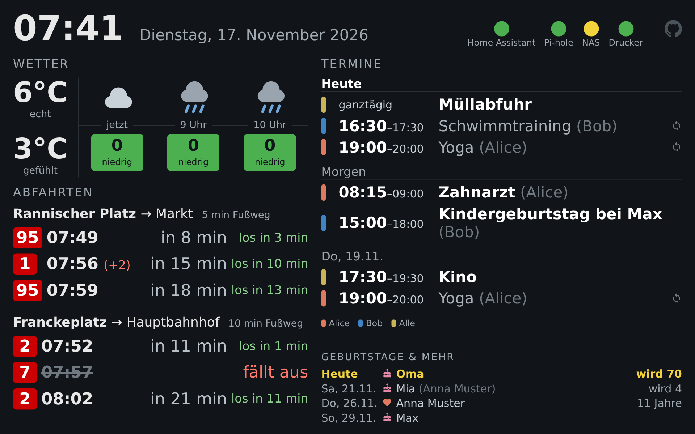

# home-dashboard

[](https://github.com/Erkenbend/home-dashboard/actions/workflows/ci.yml)
[](https://github.com/Erkenbend/home-dashboard/actions/workflows/ci.yml)
[](pyproject.toml)
[](LICENSE)
[](AGENTS.md)

**A wall display for the hallway: which tram can I still catch, what's on this week, and do I need
an umbrella?** An old Android tablet shows a page served by a Raspberry Pi. No app, no cloud, no
build step.



<sub>Made-up data, rendered at the resolution of the Galaxy Tab A 10.1 it runs on
(`scripts/screenshot.py`). The UI is German.</sub>

## What it shows

- **Abfahrten**: live departures of the trams near home, only those still reachable on foot, with
  a "los in X min" countdown to the moment you have to leave, delays and cancellations.
- **Termine**: the coming days of a shared calendar (any iCal feed), coloured by person; recurring
  events are toned down so the one-off appointments stand out.
- **Geburtstage**: optional, small below the calendar: birthdays, anniversaries and the like of
  the next two weeks from a second iCal feed, today's highlighted.
- **Wetter**: real and felt temperature now, the weather and the colour-coded UV index now and in one
  and two hours (Open-Meteo, no API key).
- **Dienste**: a green, yellow or red bubble per service in the home network, next to the date: the
  Pi checks a health URL of each one every minute.

It is built to hang on a wall unattended. The layout fits any screen without scrolling, the page
recovers from Wi-Fi drops by itself and shows "Keine Verbindung seit HH:MM" in the meantime. When an
API is down, it keeps the last known data, marked "Stand: HH:MM".

## How it works

```
Tablet, kiosk browser ──HTTP──▶ Raspberry Pi, Docker ──▶ live departures (INSA HAFAS)
  (HTMX polls widgets)          FastAPI + Jinja2       ──▶ calendar (iCal feed)
                                server-side cache      ──▶ weather (Open-Meteo)
                                                       ──▶ health URLs of home services
```

The server renders plain HTML; the tablet only needs a browser from the last decade. Each widget
reaches its data through a small interface (source → service → template), so a data source can be
swapped without touching the rest. Python 3.14, FastAPI, HTMX, uv, Docker Compose; tested at
behaviour level against recorded API responses, with layout tests in headless Chromium.

## Quick start

```sh
uv sync
cp config.example.yaml config.yaml        # stops, people, location, services
uv run home-dashboard serve               # http://localhost:3274/
```

The example config shows live trams in Halle (Saale) right away. For tests, deployment to a Pi and
the tablet, see [setup](docs/setup.md) and [tablet setup](docs/tablet.md).

## Make it yours

Out of the box the dashboard speaks German and knows the public transport of Saxony-Anhalt. Your own
stops, people, location and services are just config. Another city means one new transit provider class. Another
calendar is usually just another iCal URL. [**Customizing**](docs/customizing.md) walks through it,
including how to switch the transit data provider.

## Documentation

| | |
|---|---|
| [Setup](docs/setup.md) | development, tests, deployment to a Raspberry Pi |
| [Tablet setup](docs/tablet.md) | kiosk browser on an old Android tablet, hardware tips |
| [Customizing](docs/customizing.md) | config, other transit providers, calendars, language, new widgets |
| [Architecture](docs/architecture.md) | components, caching, fit-to-screen, testing strategy |
| [Requirements](docs/requirements.md) · [Implementation plan](docs/implementation-plan.md) | what it should do and how it got there |
| Decisions | [0001 Stack](docs/decisions/0001-stack-and-operations.md) · [0002 Calendar via iCal](docs/decisions/0002-calendar-via-ical.md) · [0003 Transit data](docs/decisions/0003-transit-data-source.md) · [0004 Weather](docs/decisions/0004-weather-via-open-meteo.md) · [0005 Health checks](docs/decisions/0005-service-health-checks.md) |

## Notes

- A personal hobby project, written together with an AI coding agent (see [AGENTS.md](AGENTS.md)).
- The departures use INSA's unofficial HAFAS interface, which may change without notice; an optional
  live test (`uv run pytest -m live`) notices it.
- Meant for the home network only: there is no authentication.

## License

[MIT](LICENSE)
